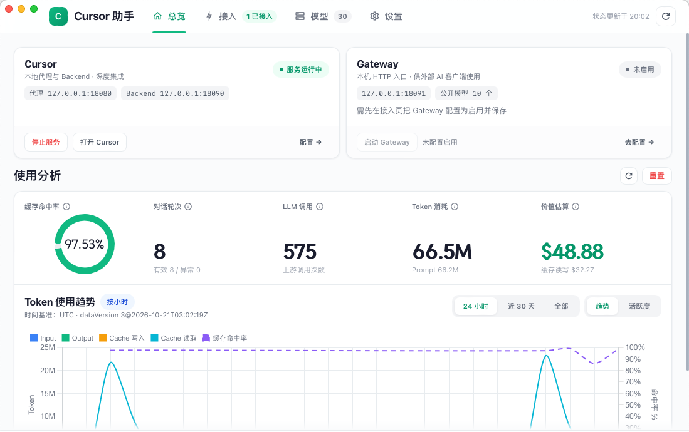
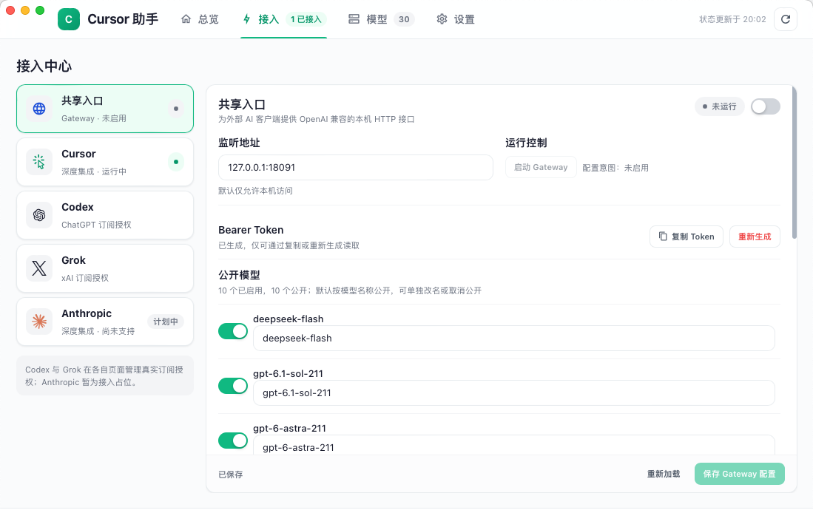

# Gateway-byok

> 让 Cursor 用上你自己的模型 API，同时保留 Cursor 官方模型；再把同一个模型池通过本机 OpenAI 兼容入口，共享给 Codex、Grok、脚本和其他 AI 客户端。
>
> 当前最新版本：**[v1.77.0](https://github.com/yaogjim/cursor-byok/releases/tag/v1.77.0)**

[下载最新版](https://github.com/yaogjim/cursor-byok/releases/latest) · [问题反馈](https://github.com/yaogjim/cursor-byok/issues) · [历史版本](https://github.com/yaogjim/cursor-byok/releases)



## 30 秒读懂

Gateway-byok 不是简单地“把 Cursor 的地址改掉”，而是在本机做一层**模型路由器**：

- **Cursor 的请求可以分流**：BYOK 模型走你自己的 API，官方模型继续走 Cursor 官方，两边可以同时存在。
- **一个模型池可以多处复用**：除了 Cursor，还能通过 `http://127.0.0.1:18091/v1` 这个 OpenAI 兼容入口给 Codex、Grok、脚本或其他客户端使用。
- **切换有边界**：只有当前请求“还没有输出、还没有执行工具”时，才允许换渠道；已经开始干活的任务不会被悄悄重跑。
- **长会话更抗断**：上下文超限会自动压缩并重试，流断开会续写，子任务结果会持久化并在后续请求里接着用。

一句话：**把“官方额度 + 自己的 API + 订阅账号”放在同一个本地入口后面，按模型精确路由，而不是二选一。**

## 它解决什么问题

| 常见困扰 | Gateway-byok 的做法 |
| --- | --- |
| 官方模型不够用，或想用自己熟悉的模型 | 接入任意 OpenAI / Anthropic 兼容 API，模型参数、Header、推理强度都可配 |
| 既想保留官方模型，又想用 BYOK | 官方与本地目录共存，模型来源标 `[官方]` / `[BYOK]`；同名冲突时本地渠道优先，其余走官方 |
| 每个客户端都要重复填地址和 key | 一个共享入口、一套模型池，Cursor / Codex / Grok / 脚本共用 |
| 某个渠道超时或限流，任务直接失败 | 主渠道之外最多再配 4 个物理候选渠道，只在安全窗口内切换 |
| 上下文太长，会话突然报错 | 自动压缩上下文，并在同一次运行里重试一次 |
| 长任务、子任务、流式输出容易中断 | 流续写、终态只落一次、检查点确认、子任务结果跨请求恢复 |
| 想看用量，又担心日志泄露内容 | 展示 Token、缓存命中率、价值估算；审计默认关闭，普通日志不写正文和密钥 |

## 分支定位

`main` 是当前主线：由原 `noad` 分支承接并合并 `gateway`，包含全部最新能力。

| 你想做的事 | 应该去的分支 |
| --- | --- |
| 使用最新功能：本地路由、共享入口、Codex / Grok 订阅账号、CLI | [`main`](https://github.com/yaogjim/cursor-byok/tree/main) |
| 参与功能开发 | [`gateway`](https://github.com/yaogjim/cursor-byok/tree/gateway) |
| 使用带 Docker CLI 的版本 | [`cli`](https://github.com/yaogjim/cursor-byok/tree/cli) |

`main` 不再跟踪任何上游仓库；新功能和修复直接进入 `main`，较大改动可先在 `gateway` 开发后合入。

## 核心能力

### 1. 本地分流：官方和 BYOK 可以同时用

客户端请求先到本机，再按模型精确决定去向：

- 能识别的 BYOK 模型走本地渠道；
- 其余模型（包括自动选择）保持 Cursor 官方身份；
- 本地渠道失败时**不会隐式切到官方**，避免把一次请求悄悄变成另一种计费或另一种上下文；
- 官方与 BYOK 两条链路互不替代，一个失败不会自动换到另一个。

这适合“官方额度留着应急，日常用自己模型”的用法，也适合反过来以官方为主、个别任务用 BYOK。

### 2. 共享入口：一个地址，多个客户端

在「接入中心」启用共享入口后，本机会出现一个 OpenAI 兼容服务：

```text
Base URL: http://127.0.0.1:18091/v1
鉴权:     Bearer Token（客户端里生成/复制）
```

支持：

- `GET /v1/models`
- `POST /v1/chat/completions`
- `POST /v1/responses`

入口只接受本机回环请求，默认不对局域网开放。你可以选择哪些模型对外公开、公开时用什么别名；公开别名只用于外部调用，不会影响 Cursor 内部的模型 ID。

### 3. 订阅账号池：Codex 与 Grok

除了 API Key，还可以直接授权订阅账号：

- **Codex**：ChatGPT 订阅授权；
- **Grok**：xAI 订阅授权；
- 支持多账号、用量刷新、额度耗尽识别、账号亲和（同一会话尽量落在同一账号）；
- 支持从 sub2api 文件导入账号；
- Anthropic 目前是接入位，深度集成仍在计划中。

这样同一套模型目录里可以同时出现：自己的 API、Codex 订阅、Grok 订阅。

### 4. 渠道治理：会切换，但不乱切换

一个逻辑模型后面可以挂：

- 1 个主渠道；
- 最多 4 个物理候选渠道；
- 整条链路共享 HTTP 尝试预算和退避等待上限。

切换只发生在“当前请求还没有产生模型输出、还没有执行工具、没有文件或外部副作用”的窗口。已经输出了一半、已经改了文件、已经调用了工具，就停止切换，交给上层处理，避免重复执行。

另外还有：

- 可选的并发容量保护，避免把某个渠道打爆；
- Provider 400 错误只保留脱敏摘要；
- 托管 Codex 渠道遵守它自己的请求字段白名单，不强行塞不支持的参数。

### 5. Agent 能力保留

接入 BYOK 后，Cursor 的 Agent 能力仍然可用：

- 工具调用、Skills、MCP；
- 检查点与历史恢复；
- 上下文压缩；
- Shell / 工具流式输出；
- 子代理（subagent）任务；
- 编辑类任务的完成校验：必须有一次成功修改，以及一次**晚于该修改**的成功验证；口头说“改好了”不算完成。

### 6. 长会话和流式输出更稳

- 上下文溢出时自动压缩，并在同一次运行里重试一次；
- 摘要触到输出上限时会识别截断信号，只在无工具副作用时重试，并把预算提高到最多 8192；
- 流式响应断开后可以续写；
- 终态只提交一次，避免重复消息；
- 检查点 Blob 校验通过并收到客户端确认后才发布；
- 已派发的子任务结果会持久化；旧请求结束、后端重启或新请求没有内存等待记录时，只要身份和父会话能精确匹配，迟到的结果仍可落盘。

### 7. 可观测、默认克制

- 总览展示缓存命中率、对话轮次、Token 消耗、价值估算和趋势；
- 模型页支持搜索、筛选、列表/栅格、批量测试、导入导出；
- 自带日志分析器，支持结构化查询和脱敏导出；
- 审计默认关闭；普通日志不写请求/响应正文、密钥和子代理内容；
- 广告默认关闭，关闭时不请求远端广告；
- 默认浅色主题；
- 更新检查、下载、安装分三个阶段，未确认不会自动下载或安装。

### 8. CLI 也能用

同一个模型池可以给 Cursor CLI 使用：

- [`cursor-cli-docker/`](./cursor-cli-docker/README.md)：Docker 内运行 Cursor CLI，并提供 WeTTY 浏览器终端；
- [`tools/cursor-cli-model-pool/`](./tools/cursor-cli-model-pool/README.md)：按顺序切换物理模型的独立控制器，只在零输出、零副作用窗口切换；
- CLI 指向本机后端 `http://127.0.0.1:18090`，不需要把真实 API Key 写进 CLI 配置。

## 界面

### 接入中心

一个页面管理四类接入：共享入口、Cursor、Codex、Grok。每个入口独立启停、独立配置、独立保存。


### 模型管理

同一个列表里管理 BYOK、Codex、Grok 和官方模型；可以启停、搜索、筛选、测试和导入导出。



## 快速开始

1. 从 [Releases](https://github.com/yaogjim/cursor-byok/releases/latest) 下载对应平台的安装包（最新版提供 macOS Apple Silicon 与 Intel 构建）。
2. 打开 Gateway-byok，在「上游模型」里添加你的 API：填写接口地址、API Key、模型 ID，并选择 `/v1/chat/completions`、`/v1/responses` 或自定义路径。
3. 在「接入中心」按需要选择一种或两种用法：
   - **Cursor 深度集成**：启动本地服务，按页面提示让 Cursor 走本机代理；
   - **共享入口**：启用 Gateway，复制 `http://127.0.0.1:18091/v1` 和 Bearer Token 到其他客户端。
4. 需要 Codex / Grok 时，在对应面板完成订阅授权，再把它们加入模型列表。
5. 打开 Cursor，选择模型开始使用 Chat 或 Agent。

## 工作原理

```text
Cursor / Codex / Grok / 其他客户端
                 │
        ┌────────┴─────────┐
        │                  │
  Cursor 本地代理      共享入口
  127.0.0.1:18080    127.0.0.1:18091/v1
        │                  │
        └────────┬─────────┘
                 │
          精确路由 / 渠道选择
                 │
     ┌───────────┼────────────┐
     │           │            │
  BYOK API   订阅账号池     Cursor 官方
```

## 分支说明

本仓库只保留三个长期分支，各自定位如下：

| 分支 | 定位 | 说明 |
| --- | --- | --- |
| `main` | **主线（默认分支）** | 由原 `noad` 分支承接并合并 `gateway`，路由、官方/BYOK 共存、共享入口、订阅账号、CLI 全量能力，版本最新 |
| `gateway` | 功能开发分支 | 路由、官方/BYOK 共存、共享入口、订阅账号、CLI 的持续开发线 |
| `cli` | CLI 功能版 | 在 noad 基础上加入 Docker CLI、WeTTY 和 CLI 模型池，停留在 v0.0.49.x |

本仓库已不再与原上游仓库保持同步，`main` 只承载本项目自己的改动。

需要最新功能、共享入口或订阅账号，请使用 `gateway`。

## 兼容与边界

- 本项目是独立的本地工具，与 Cursor 官方无隶属或背书关系；使用官方模型仍需遵守 Cursor 的服务条款。
- 共享入口只监听回环地址，定位是本机多客户端复用，不是公网网关。
- Anthropic 深度集成仍在计划中，当前只提供接入位。
- 子任务恢复只接管能够验证派发身份和父会话关联的结果，不自动重启已取消任务。
- 本地渠道与官方渠道失败时不会自动互换；Provider fallback 也只在零输出、零副作用窗口生效。
- 日志默认不记录正文和凭据，但任何“未观察到泄露”都不能单独等同于“绝对没有泄露”；敏感环境请自行做网络与权限隔离。

## 许可证

本项目基于 [MIT License](./LICENSE) 开源。