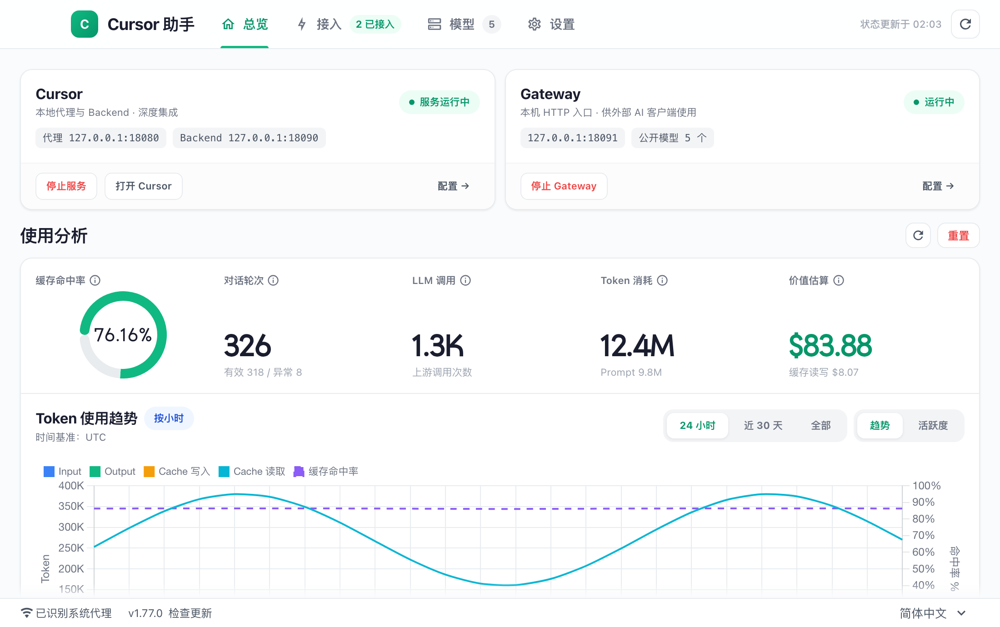
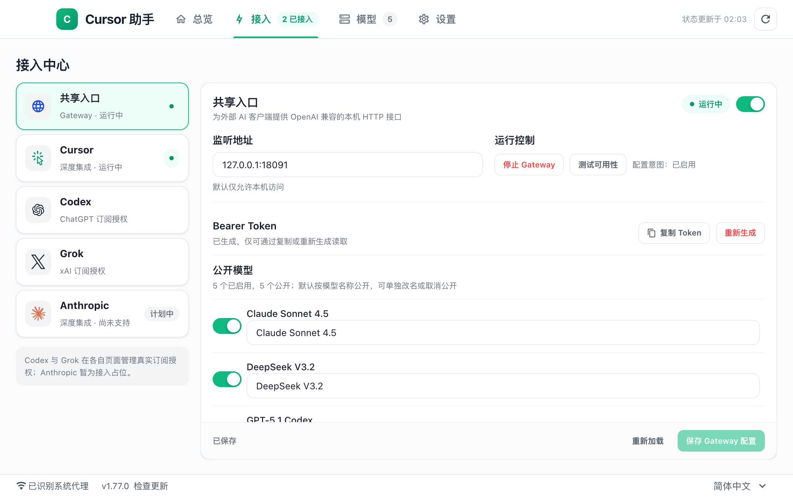
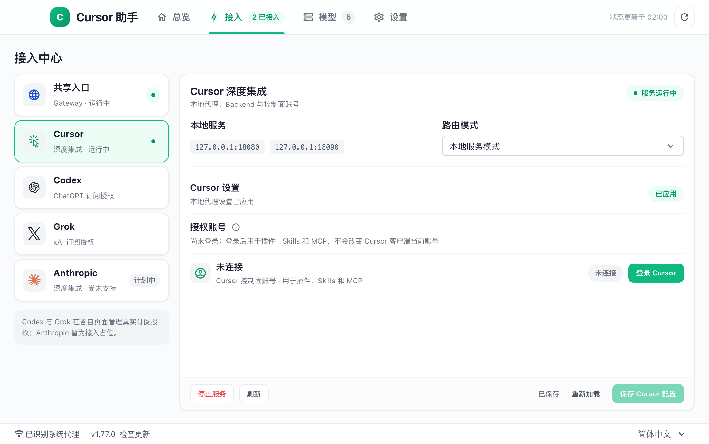
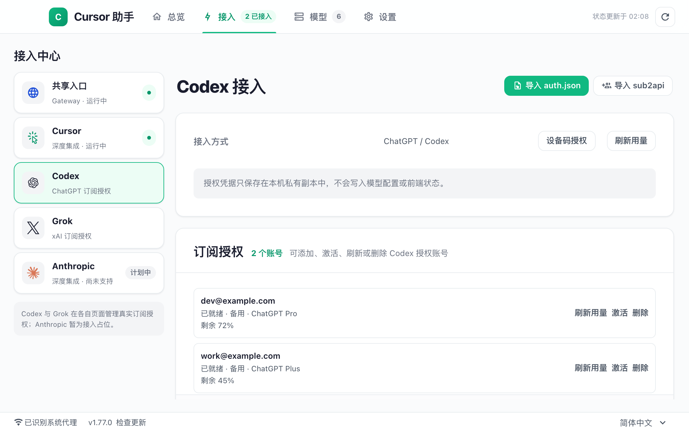
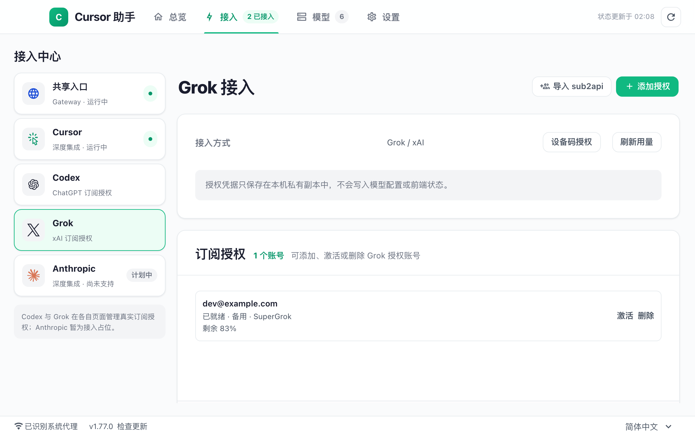
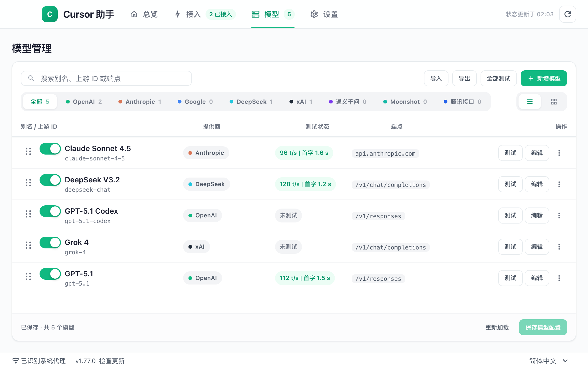
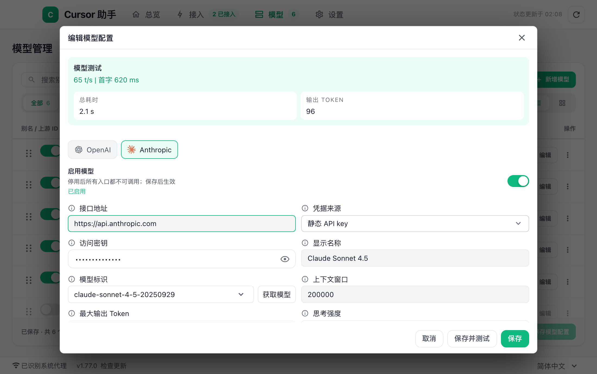
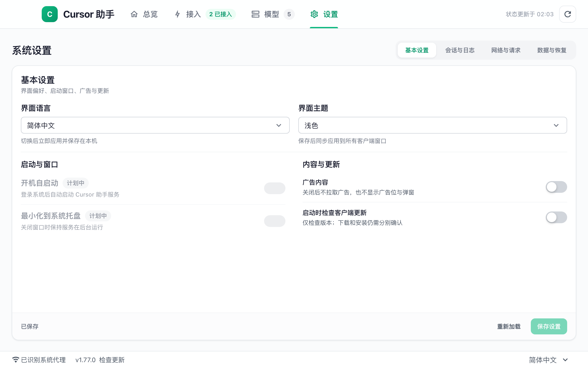
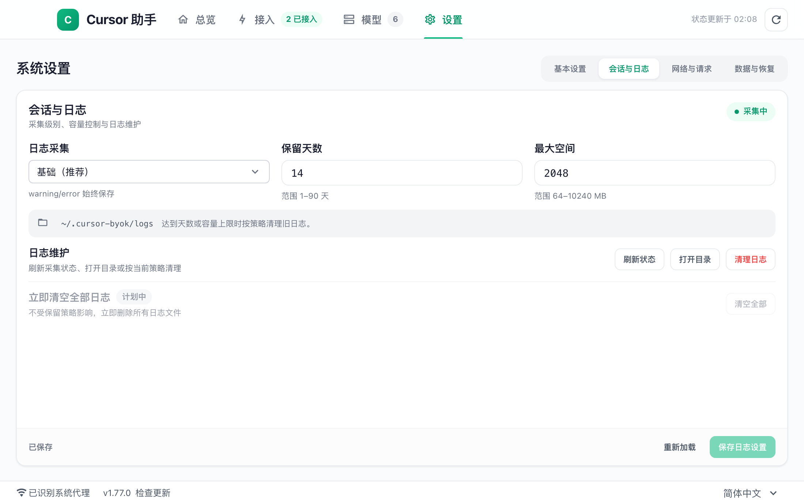
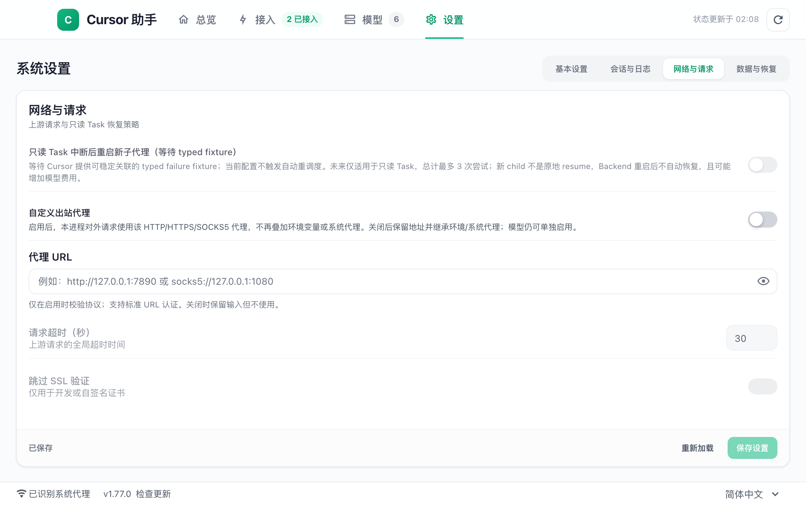

# cursor-byok ：**在 Cursor 中接入任意模型（via** BYOK）

简体中文 · [English](./README_EN.md)

> **在 Cursor 中接入任意模型，任意供应商、无限畅用。**
>
> 模型由你选，供应商由你定。把自己的模型 API 或 Codex / Grok 订阅接入 Cursor Chat 与 Agent，继续使用熟悉的编程工作流，同时保留 Cursor 官方模型；一套本地模型池，还能共享给其他 AI 客户端和脚本。
>
> 接入以协议兼容为前提；“无限畅用”强调模型与供应商的选择自由，不代表免费或免除供应商的额度、速率及服务条款限制。

## 30 秒读懂

**cursor-byok 让你在 Cursor 中自由接入不同供应商的兼容模型，在本机统一路由与管理。** BYOK（Bring Your Own Key）就是使用你自己的模型 API Key；这里还支持接入 Codex / Grok 订阅账号。

- **模型与供应商由你选**：通过兼容 API 接入你想用的模型，在熟悉的 Cursor 里继续使用 Agent 的工具调用、Skills 和 MCP（模型上下文协议）等能力；具体效果取决于上游模型的能力与协议兼容性。
- **官方与自有模型，可以同时保留**：日常用自己的 API，特定任务选官方模型，或反过来；按模型精确路由，不必二选一。
- **配置一次，多处使用**：把本地模型池通过 OpenAI 兼容入口，共享给 Codex、Grok、脚本或其他兼容客户端，减少重复维护地址、Key 和模型列表。
- **长任务有恢复机制，渠道切换有边界**：上下文超限可自动压缩重试，流中断可续写；备用渠道只在零输出、零工具执行、零副作用的安全窗口内切换，避免已执行的操作被重复执行。

一句话：**在 Cursor 里自由选模型、选供应商，用自己的 API 和订阅开展编程工作，再把同一套本地模型池复用到其他工具。**



## 为什么值得用

- **模型自由选**：接入 OpenAI / Anthropic 兼容 API，继续在熟悉的 Cursor 中使用 Chat 与 Agent。
- **官方、API、订阅共存**：按任务选择 Cursor 官方模型、自有 API 或 Codex / Grok 订阅。
- **配置一次，多处复用**：同一套本地模型池共享给其他兼容客户端和脚本。
- **减少任务中断影响**：上下文压缩、流续写与安全渠道切换，为长任务提供恢复机制。
- **用量看得清**：集中查看 Token 消耗、缓存命中率与价值估算。

## 快速开始

1. **下载安装**：从 [Releases](https://github.com/yaogjim/cursor-byok/releases/latest) 下载适合你的 macOS / Windows / Linux 安装包。
2. **接入模型**：在「上游模型」填写 API 地址、Key 和模型 ID；或在「接入中心」授权 Codex / Grok 订阅，再添加对应模型。保存并测试模型。
3. **开始使用**：在「接入中心」配置 Cursor、启动本地服务，按提示完成代理配置；打开 Cursor，选模型即可开始 Chat 或 Agent 任务。

**其他客户端（可选）**：在「接入中心」启用并保存共享入口（Gateway），选择公开模型及别名后启动；客户端填写 `http://127.0.0.1:18091/v1`、入口令牌和公开模型别名。入口令牌用于客户端的 API Key 字段，无需填写上游 Key。

模型费用、额度及使用权限以对应服务商为准。

## 界面

### 接入中心

一个页面管理共享入口、Cursor、Codex、Grok 四类接入，每个入口独立启停、配置和保存。









### 模型管理

在同一列表中管理自有 API、Codex、Grok 与官方模型，支持启停、搜索、筛选、连接测试和导入导出。





### 系统设置

集中配置界面语言、主题、启动与窗口行为、广告、更新检查、网络代理和日志。







*截图为界面示意，数据仅用于展示。*

## 核心能力


### 1. 本地分流：官方和 BYOK 可以同时用

客户端请求先到本机，再按模型精确决定去向：

- 能识别的 BYOK 模型走本地渠道，同名冲突时本地渠道优先；
- 其余模型（包括自动选择）保持 Cursor 官方身份；
- 本地渠道失败时**不会隐式切到官方**，避免把一次请求悄悄变成另一种计费或另一种上下文；
- 官方与 BYOK 两条链路互不替代，一个失败不会自动换到另一个。

这适合“官方额度留着应急，日常用自己模型”的用法，也适合反过来以官方为主、个别任务用 BYOK。

### 2. 共享入口：一个地址，多个客户端

在「接入中心」启用共享入口后，本机会出现一个 OpenAI 兼容服务：

```text
Base URL: http://127.0.0.1:18091/v1
鉴权:     Bearer Token（客户端里生成/复制）
```

支持：

- `GET /v1/models`
- `POST /v1/chat/completions`
- `POST /v1/responses`

入口只接受本机回环请求，默认不对局域网开放。你可以选择哪些模型对外公开、公开时用什么别名；公开别名只用于外部调用，不会影响 Cursor 内部的模型 ID。

### 3. 订阅账号池：Codex 与 Grok

除了 API Key，还可以直接授权订阅账号：

- **Codex**：ChatGPT 订阅授权；
- **Grok**：xAI 订阅授权；
- 支持多账号、用量刷新、额度耗尽识别、账号亲和（同一会话尽量落在同一账号）；
- 支持从 sub2api 文件导入账号；
- Anthropic 订阅目前是接入占位，深度集成仍在计划中；这与已支持的 Anthropic 兼容 API 接入是两回事。

这样同一套模型目录里可以同时出现：自己的 API、Codex 订阅、Grok 订阅。

### 4. 渠道治理：会切换，但不乱切换

一个逻辑模型后面可以挂：

- 1 个主渠道；
- 最多 4 个物理候选渠道；
- 整条链路共享 HTTP 尝试预算和退避等待上限。

切换只发生在“当前请求还没有产生模型输出、还没有执行工具、没有文件或外部副作用”的窗口。已经输出了一半、已经改了文件、已经调用了工具，就停止切换，交给上层处理，避免重复执行。

另外还有：

- 可选的并发容量保护，避免把某个渠道打爆；
- Provider 400 错误只保留脱敏摘要；
- 托管 Codex 渠道遵守它自己的请求字段白名单，不强行塞不支持的参数。


### 5. Agent 能力保留

接入 BYOK 后，Cursor 的 Agent 能力仍然可用：

- 工具调用、Skills、MCP；
- 检查点与历史恢复；
- 上下文压缩；
- Shell / 工具流式输出；
- 子代理（subagent）任务；
- 编辑类任务的完成校验：必须有一次成功修改，以及一次**晚于该修改**的成功验证；口头说“改好了”不算完成。


### 6. 长会话和流式输出更稳

- 上下文溢出时自动压缩，并在同一次运行里重试一次；
- 摘要触到输出上限时会识别截断信号，只在无工具副作用时重试，并把预算提高到最多 8192；
- 流式响应断开后可以续写；
- 终态只提交一次，避免重复消息；
- 检查点 Blob 校验通过并收到客户端确认后才发布；
- 已派发的子任务结果会持久化；旧请求结束、后端重启或新请求没有内存等待记录时，只要身份和父会话能精确匹配，迟到的结果仍可落盘。


### 7. 可观测、默认克制

- 总览展示缓存命中率、对话轮次、Token 消耗、价值估算和趋势；
- 模型页支持搜索、筛选、列表/栅格、批量测试、导入导出；
- 自带日志分析器，支持结构化查询和脱敏导出；
- 审计默认关闭；普通日志不写请求/响应正文、密钥和子代理内容；
- 广告默认关闭，关闭时不请求远端广告；
- 默认浅色主题；
- 更新检查、下载、安装分三个阶段，未确认不会自动下载或安装。


### 8. CLI 也能用

同一个模型池可以给 Cursor CLI 使用：

- `[cursor-cli-docker/](./cursor-cli-docker/README.md)`：Docker 内运行 Cursor CLI，并提供 WeTTY 浏览器终端；
- `[tools/cursor-cli-model-pool/](./tools/cursor-cli-model-pool/README.md)`：按顺序切换物理模型的独立控制器，只在零输出、零副作用窗口切换；
- CLI 指向本机后端 `http://127.0.0.1:18090`，不需要把真实 API Key 写进 CLI 配置。


## 工作原理

```text
Cursor
  └─ 本地代理 127.0.0.1:18080
       ├─ 官方模型 → Cursor 官方
       └─ BYOK 模型 → 本地模型池

其他兼容客户端 / 脚本
  └─ 共享入口 127.0.0.1:18091/v1 → 本地模型池

本地模型池 / 渠道选择
  ├─ 自有模型 API
  └─ Codex / Grok 订阅账号池
```

Cursor 官方模型保留在 Cursor 链路中；共享入口只公开你选择的本地模型。

## 兼容与边界

- 本项目是独立的本地工具，与 Cursor 官方无隶属或背书关系；使用官方模型仍需遵守 Cursor 的服务条款，使用 API 和订阅账号也需遵守对应服务商的条款。
- Agent 的可用性与效果取决于上游模型的工具调用能力、协议兼容性及 Cursor 版本，接入后请先测试实际任务。
- 本地运行的是路由与管理服务，不等于离线推理；请求仍会发往你选择的上游服务。
- 共享入口只监听回环地址，定位是本机多客户端复用，不是公网网关，也不转供 Cursor 官方额度。
- Anthropic 订阅深度集成仍在计划中，当前只提供接入占位；Anthropic 兼容 API 可按 API 渠道接入。
- 子任务恢复只接管能够验证派发身份和父会话关联的结果，不自动重启已取消任务。
- 本地渠道与官方渠道失败时不会自动互换；Provider fallback 也只在零输出、零副作用窗口生效。
- 日志默认不记录正文和凭据，但任何“未观察到泄露”都不能单独等同于“绝对没有泄露”；敏感环境请自行做网络与权限隔离。


## 许可证

本项目基于 [MIT License](./LICENSE) 开源。