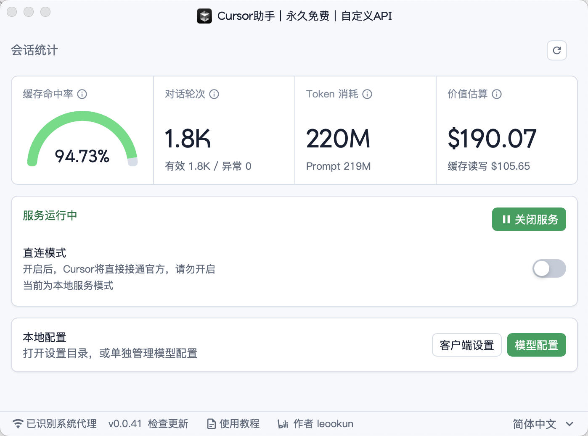

# Cursor BYOK cli

> 在早期无广告客户端的基础上，加入 Cursor CLI 支持：在 Docker 里运行 Cursor CLI、用浏览器终端操作、并用独立控制器安全切换 CLI 模型。
>
> 当前源码版本：**v0.0.49.6**。该分支没有单独发布安装包，建议从源码构建；需要最新功能请使用 [`gateway`](https://github.com/yaogjim/cursor-byok/tree/gateway) 分支。

[Releases](https://github.com/yaogjim/cursor-byok/releases) · [问题反馈](https://github.com/yaogjim/cursor-byok/issues) · [CLI 操作手册](./docs/ops_198_cursor_cli_session_reuse.md)



## 分支定位

| 分支 | 定位 |
| --- | --- |
| `cli` | **当前分支**：在 noad 基础上加入 Docker CLI、WeTTY 和 CLI 模型池 |
| `gateway` | 最新主线：路由、官方/BYOK 共存、共享入口、订阅账号，并且已经包含 CLI 能力 |
| `noad` | 早期无广告版，停留在 v0.0.49.x |
| `main` | 上游镜像，与 [leookun/cursor-byok](https://github.com/leookun/cursor-byok) 保持一致 |

如果你只是想在 Cursor 桌面端使用 BYOK，`noad` 就够用；如果你想把同一套模型接到 CLI、或者想用共享入口和订阅账号，建议直接使用 `gateway`。

## CLI 能力

### 1. 在 Docker 里运行 Cursor CLI

构建上下文在 [`cursor-cli-docker/`](./cursor-cli-docker/README.md)：

- 基础镜像 `oven/bun:1.3.14-slim`，内置 Node.js；
- 浏览器终端使用 [WeTTY](https://github.com/butlerx/wetty)（xterm.js），不是 ttyd；
- 预装 `agent-browser` 和 Chrome for Testing，方便在容器里做浏览器自动化；
- CLI 与 `auth.json` 放在 bind mount（`/home/bun`），不打进镜像；
- WeTTY 只监听 `127.0.0.1:7681`，TLS 和 HTTP Basic 由宿主机 nginx 终止。

构建和验收步骤见 [`cursor-cli-docker/README.md`](./cursor-cli-docker/README.md) 与 [`docs/ops_198_cursor_cli_session_reuse.md`](./docs/ops_198_cursor_cli_session_reuse.md)。

> 把桌面/CLI 会话复制到 Linux `auth.json` 属于非官方用法，Cursor 官方不支持。不要把真实 token、refresh token、`auth.json` 正文或密码提交进仓库。

### 2. CLI 模型池：只在安全窗口切换

[`tools/cursor-cli-model-pool/`](./tools/cursor-cli-model-pool/README.md) 是一个独立命令，用配置里的物理模型顺序启动 Cursor Agent CLI：

```sh
# 校验配置、Agent 模型列表和 physical-only 约束
cursor-cli-model-pool validate

# 只显示将执行的 argv，不启动任务
cursor-cli-model-pool dry-run

# prompt 只从 stdin 输入，不进入 argv
printf '%s' '只回答 OK，不调用工具。' | cursor-cli-model-pool run
```

它的核心规则：

- 只接受**物理模型**，拒绝启用 Provider fallback 的逻辑 alias，避免外层切换和内层 fallback 形成乘法重试；
- 只有当前进程仍然“零模型输出、零工具调用、零文件或外部副作用”时，才允许切到下一个模型；
- 认证错误、其他 4xx/5xx、取消、NDJSON 解析失败和未知错误都会停止，不根据错误文本猜测换模型；
- 不传 `--force`、`--yolo`，也不会自动批准 MCP 工具；
- `write` 模式使用 Cursor 自己创建的隔离 worktree，控制器只监视，不执行 `git worktree add`；
- journal 不保存正文，API Key 只在内存中参与渠道 ID 计算。

配置示例：

```yaml
schemaVersion: 1
agentPath: /absolute/path/to/agent
endpoint: http://127.0.0.1:18090
models:
  - 0123456789abcdef
  - fedcba9876543210
mode: ask
worktreeNamePrefix: cursor-pool
safety:
  allowWrite: false
```

完整的字段合同、退出码和 journal 说明见 [`tools/cursor-cli-model-pool/README.md`](./tools/cursor-cli-model-pool/README.md)。

### 3. 给主 Agent 和子代理分配不同模型

CLI 容器内的主 Agent 与 custom subagent 可以走不同的模型路由，配置方法见 [`cursor-cli-docker/subagent-pool.md`](./cursor-cli-docker/subagent-pool.md)。

## 快速开始

1. 启动 Cursor BYOK cli，在「模型配置」里填写接口地址、API Key 和模型 ID，测试通过后启动本地服务。CLI 默认使用本机后端 `http://127.0.0.1:18090`。
2. 按 [`cursor-cli-docker/README.md`](./cursor-cli-docker/README.md) 构建镜像，并用 `--network host` 启动容器。
3. 准备 CLI 凭据（推荐官方 `agent login` 或 `CURSOR_API_KEY`；非官方会话复用请自行评估风险），把 `auth.json` 放到 bind mount。
4. 打开 WeTTY 页面，在容器里运行 `agent`；需要模型池时再配置 `cli-model-pool.yaml`，先 `validate`、再 `dry-run`、最后 `run`。

## 客户端核心能力

CLI 之外，这个分支保留了 noad 的桌面客户端能力：

- 接入 OpenAI、Anthropic 或兼容接口，保留 Cursor 的 Chat、Agent、工具调用、Skills 和 MCP；
- 模型 ID、上下文窗口、推理参数、自定义 Header 和额外请求参数可配；
- Provider fallback 默认关闭；启用后最多 1 个主渠道 + 4 个物理候选渠道，只在无输出、无副作用窗口切换；
- 编辑类任务要求“成功修改 + 晚于修改的成功验证”，口头声明不算完成；
- 展示 Token 消耗、缓存命中率、对话摘要和模型测试状态；
- 公共 Agent transcript 不写入 reasoning、signature、内部回放或凭据；
- 广告默认关闭，更新检查、下载、安装分阶段确认，默认浅色主题。

## 安全边界

- Docker 容器使用 host 网络时，WeTTY 必须只绑定 `127.0.0.1`，并由宿主机 nginx 终止 TLS；不要把 7681 直接映射到公网。
- 不要提交或打印真实 token、`auth.json`、htpasswd、SSH 密码。
- CLI 模型池只负责“换模型”，不负责重放已经失败的任务；失败后进入人工复核。
- 非官方会话复用可能随 Cursor CLI 版本变化失效，升级前先在隔离环境验证。
- 本项目是独立工具，与 Cursor 官方无隶属或背书关系。

## 许可证

本项目基于 [MIT License](./LICENSE) 开源。