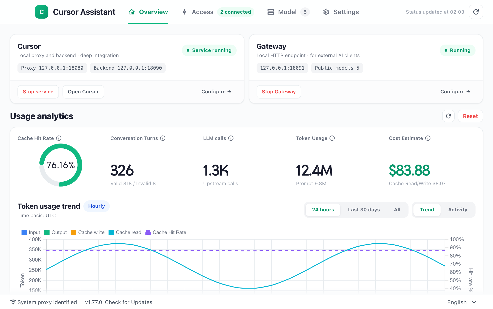
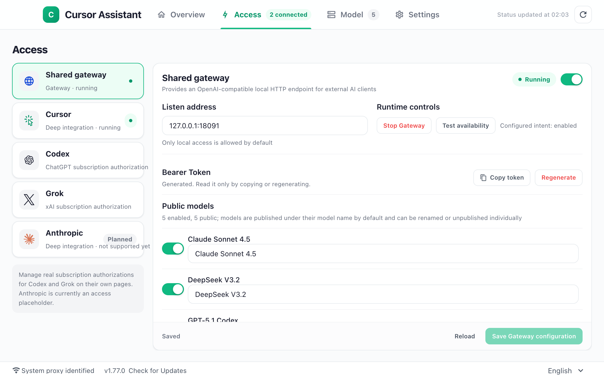
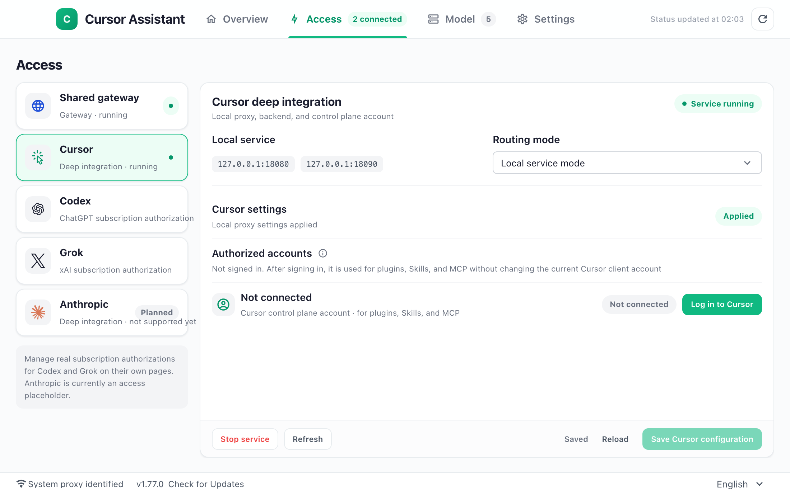
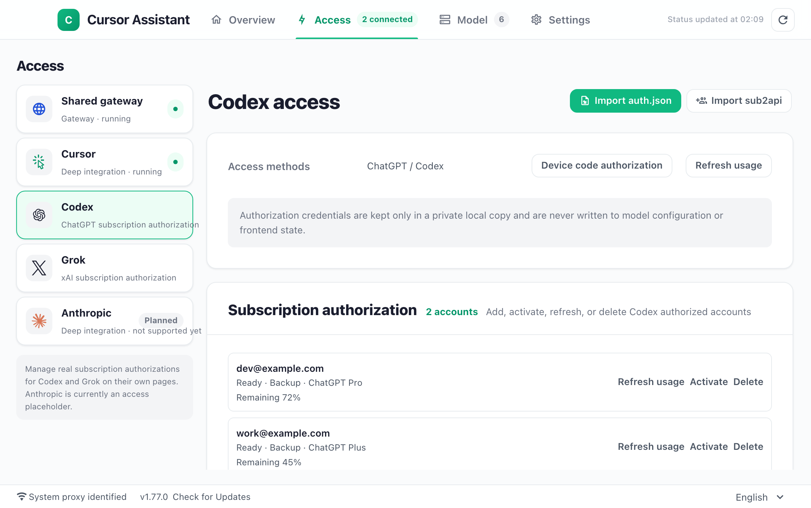
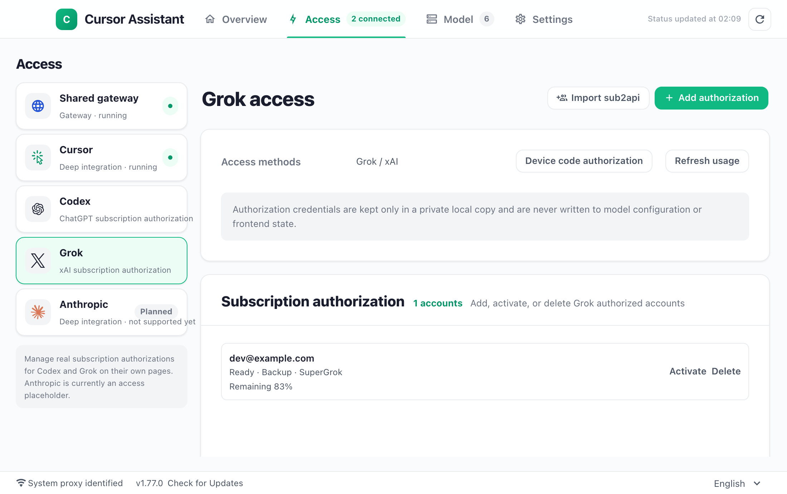
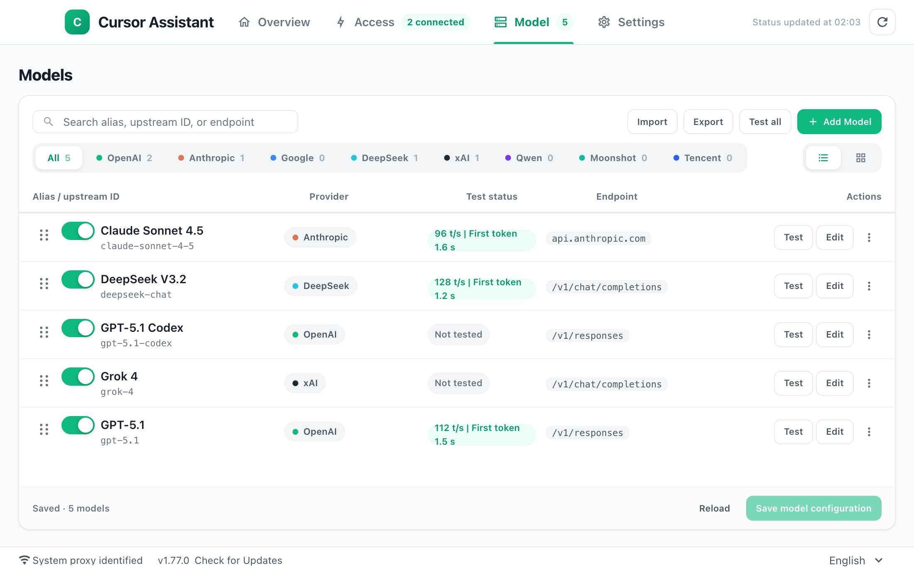
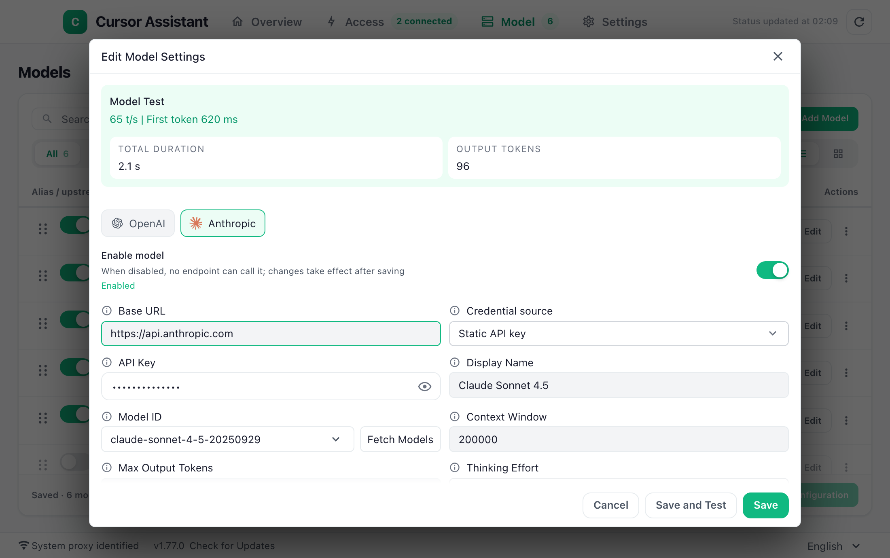
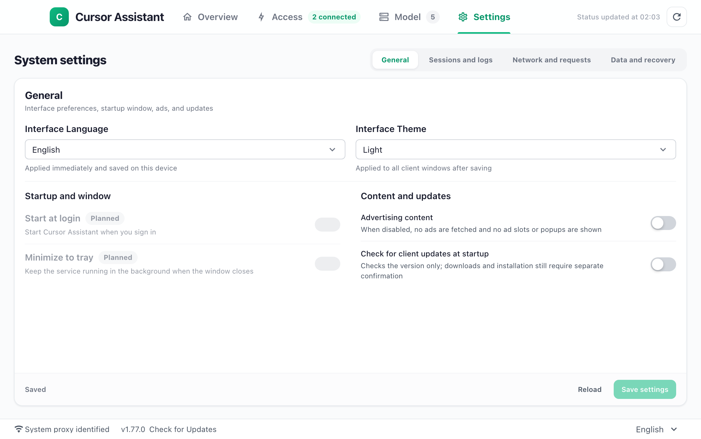
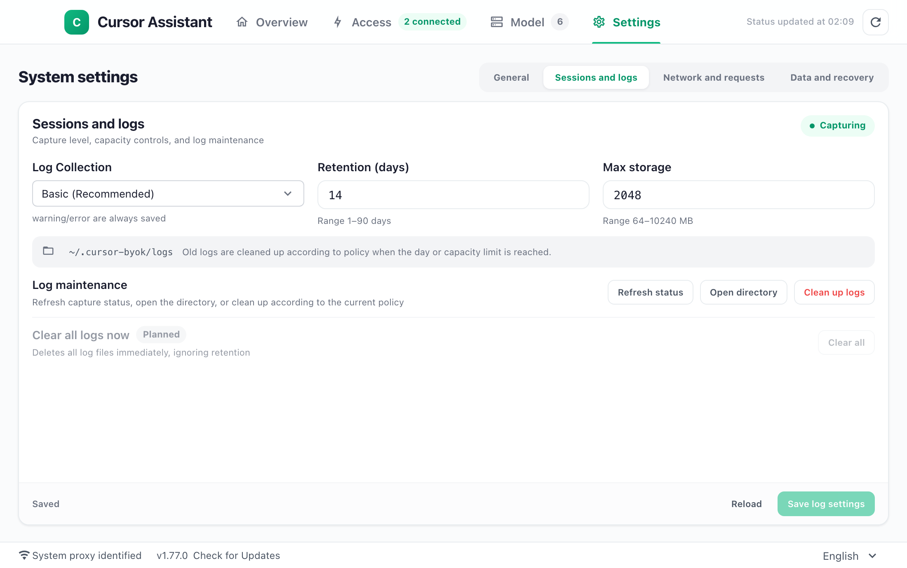
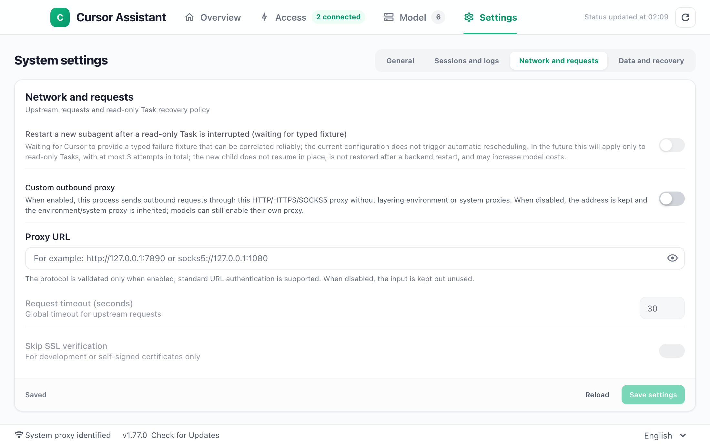

# cursor-byok

[简体中文](./README.md) · English

> **Any model in Cursor. Any provider. Unlimited use.**
>
> You choose the models and providers. Connect your own model APIs or Codex / Grok subscriptions to Cursor Chat and Agent, keep your familiar coding workflow, and retain access to Cursor's official models. Share the same local model pool with other AI clients and scripts, too.
>
> Connections require protocol compatibility. “Unlimited use” describes freedom of model and provider choice, not free service or exemption from provider quotas, rate limits, or terms of service.

## The 30-second version

**cursor-byok lets you connect compatible models from different providers in Cursor, with routing and management handled locally.** BYOK means Bring Your Own Key: use your own model API key. The app also supports Codex / Grok subscription accounts.

- **Your choice of models and providers.** Connect the models you want through compatible APIs and keep using Agent tool calls, Skills, and MCP (Model Context Protocol) in the Cursor editor you know. Results depend on the upstream model's capabilities and protocol compatibility.
- **Keep both official and bring-your-own models.** Use your API for everyday work and official models for specific tasks, or the other way around. Requests are routed by model, so you can keep both options.
- **Configure once, use across tools.** Share your local model pool through an OpenAI-compatible endpoint with Codex, Grok, scripts, or other compatible clients. Maintain fewer copies of URLs, keys, and model lists.
- **Recovery for long tasks, clear limits on fallback.** Context overflow can trigger compression and a retry; interrupted streams can continue. Fallback channels are used only before any model output, tool execution, or side effects, to avoid repeating operations that have already run.

In one sentence: **Choose your models and providers in Cursor, use your own APIs and subscriptions for coding, and reuse the same local model pool in other tools.**



## Why use it

- **Choose your models.** Connect OpenAI- or Anthropic-compatible APIs and keep using Chat and Agent in the Cursor editor you know.
- **Keep official models, APIs, and subscriptions.** Choose Cursor's official models, your own APIs, or Codex / Grok subscriptions for each task.
- **Configure once, reuse across tools.** Share one local model pool with other compatible clients and scripts.
- **Reduce the impact of interruptions.** Context compression, stream continuation, and safe channel fallback provide recovery mechanisms for long tasks.
- **Understand usage.** View token consumption, cache hit rate, and estimated value in one place.

## Quick start

1. **Download and install:** Get the package for your macOS / Windows / Linux system from [Releases](https://github.com/yaogjim/cursor-byok/releases/latest).
2. **Connect a model:** Enter your API URL, key, and model ID in the upstream model settings; or authorize a Codex / Grok subscription in the access center and add its models. Save and test the model.
3. **Start using it:** Configure Cursor in the access center, start the local service, and follow the proxy setup instructions. Open Cursor, select a model, and start a Chat or Agent task.

**Other clients (optional):** Enable and save the shared endpoint (Gateway) in the access center, select public models and aliases, and start it. Set the client to `http://127.0.0.1:18091/v1`, the Gateway token, and a public model alias. Use the Gateway token in the client's API key field, not your upstream key.

Fees, quotas, and access permissions remain subject to the relevant provider.

## Screenshots

### Access center

Manage the shared endpoint, Cursor, Codex, and Grok on one page, each with independent start/stop controls, configuration, and saving.









### Model management

Manage your own APIs, Codex, Grok, and official models in one list, with enable/disable controls, search, filters, connection tests, and import/export.





### System settings

Configure interface language, theme, startup and window behavior, ads, update checks, network proxy, and logs.







*Screenshots are illustrative; data is for display only.*

## Core capabilities

### 1. Local routing: official and BYOK models side by side

Cursor requests reach the local service first and are routed by exact model identity:

- Recognized BYOK models use local channels; local channels take precedence when model names collide.
- Other models, including automatic selection, keep their Cursor official identity.
- A local channel failure **never implicitly falls back to Cursor's official service**, avoiding an unexpected change in billing or context.
- Official and BYOK routes remain separate; a failure on one does not automatically switch to the other.

Use your own models day to day and keep official access in reserve, or use official models primarily and BYOK for selected tasks.

### 2. Shared endpoint: one address, multiple clients

Enable the shared endpoint in the access center to start a local OpenAI-compatible service:

```text
Base URL: http://127.0.0.1:18091/v1
Auth:     Bearer Token (generated/copied in the app)
```

Supported endpoints:

- `GET /v1/models`
- `POST /v1/chat/completions`
- `POST /v1/responses`

The endpoint accepts loopback requests only and is not exposed to the local network by default. Choose which models to expose and give them public aliases. These aliases apply only to external calls and do not change model IDs inside Cursor.

### 3. Subscription account pools: Codex and Grok

Alongside API keys, you can authorize subscription accounts:

- **Codex:** ChatGPT subscription authorization.
- **Grok:** xAI subscription authorization.
- Multiple accounts, usage refresh, quota exhaustion detection, and account affinity (keeping a conversation on the same account where possible).
- Account import from sub2api files.
- Anthropic subscription integration is currently a placeholder; deeper integration is planned. This is separate from the existing support for Anthropic-compatible APIs.

Your own APIs, Codex subscriptions, and Grok subscriptions can appear in the same model catalog.

### 4. Channel management: fallback with clear limits

A logical model can have:

- One primary channel.
- Up to four physical fallback channels.
- A shared HTTP attempt budget and backoff limit across the entire chain.

Fallback is allowed only before the current request has produced model output, executed tools, or caused file or external side effects. Once output or tool execution has started, channel switching stops and control returns to the calling layer, to avoid duplicate execution.

Also included:

- Optional concurrency limits to protect channel capacity.
- Sanitized summaries of provider HTTP 400 errors.
- A request-field allowlist for managed Codex channels, rather than sending unsupported parameters.

### 5. Keep Agent capabilities

The Cursor integration supports these Agent capabilities with BYOK:

- Tool calls, Skills, and MCP.
- Checkpoints and history recovery.
- Context compression.
- Streaming shell and tool output.
- Subagent tasks.
- Completion checks for editing tasks: a successful modification must be followed by a successful verification **after that modification**. A verbal claim of completion is not enough.

### 6. More resilient long conversations and streams

- Context overflow triggers automatic compression and one retry in the same run.
- When a summary reaches its output limit, truncation signals are detected; retries occur only without tool side effects, with the budget raised to at most 8192.
- Interrupted streaming responses can continue.
- Terminal state is committed only once to avoid duplicate messages.
- Checkpoint blobs are published only after validation and client acknowledgment.
- Dispatched subtask results are persisted. Late results can still be saved after the original request ends, the backend restarts, or a new request has no in-memory wait record, provided the dispatch identity and parent conversation match exactly.

### 7. Usage visibility and restrained defaults

- An overview of cache hit rate, conversation turns, token consumption, estimated value, and trends.
- Model search, filters, list/grid views, batch testing, and import/export.
- A bundled log analyzer with structured queries and sanitized exports.
- Auditing is off by default; ordinary logs exclude request/response bodies, secrets, and subagent content.
- Ads are off by default, with no remote ad requests while disabled.
- Light theme by default.
- Update checks, downloads, and installation are separate stages; downloading and installing require confirmation.

### 8. CLI access

Use the same model pool with Cursor CLI:

- [`cursor-cli-docker/`](./cursor-cli-docker/README.md): runs Cursor CLI in Docker with a WeTTY browser terminal.
- [`tools/cursor-cli-model-pool/`](./tools/cursor-cli-model-pool/README.md): a standalone controller that tries physical models in order, switching only before any output or side effects.
- The CLI connects to the local backend at `http://127.0.0.1:18090`, so real upstream API keys do not need to be stored in the CLI configuration.


## How it works

```text
Cursor
  └─ Local proxy 127.0.0.1:18080
       ├─ Official model → Cursor official service
       └─ BYOK model → Local model pool

Other compatible clients / scripts
  └─ Shared endpoint 127.0.0.1:18091/v1 → Local model pool

Local model pool / channel selection
  ├─ Your model APIs
  └─ Codex / Grok subscription account pools
```

Cursor's official models stay on the Cursor route. The shared endpoint exposes only the local models you select.

## Branches

The repository maintains three long-lived branches:

| Branch | Role | Details |
| --- | --- | --- |
| `main` | **Main line (default)** | Continues the former `noad` branch with `gateway` merged in. Includes the latest routing, official/BYOK coexistence, shared endpoint, subscription accounts, and CLI capabilities. |
| `gateway` | Feature development | Development line for routing, official/BYOK coexistence, the shared endpoint, subscription accounts, and CLI. |
| `cli` | CLI edition | Adds Docker CLI, WeTTY, and the CLI model pool to the former `noad` base; remains at v0.0.49.x. |

This repository no longer synchronizes with the original upstream repository. `main` carries this project's own changes.

`main` already includes all `gateway` capabilities. Use `main` for everyday use; `gateway` remains a parallel development line.

## Build and release

Installers are built by [GitHub Actions](.github/workflows/build.yml) on hosted macOS, Windows, and Linux runners, rather than uploaded manually from local builds:

- Pushing to `main` or `gateway` builds macOS (DMG + tar.gz), Windows (ZIP + NSIS installer), and Linux (tar.gz + deb + rpm), with outputs stored as Actions artifacts.
- Pushing a `v*` tag publishes the three-platform builds and a generated `update.json` to Releases after all builds pass. The tag must equal `v` plus `info.version` in `build/config.yml`.

For local checks of one platform, use `task release:prepare:macos`, `task release:build:windows:amd64`, `task release:build:windows:installer`, `task release:build:linux:amd64`, or `task release:build:linux:installers`. See the build and release section in [`CONTRIBUTING_EN.md`](./CONTRIBUTING_EN.md) for full instructions.

## Compatibility and limits

- This is an independent local tool, not affiliated with or endorsed by Cursor. Cursor's terms still apply to official models, and the relevant provider's terms apply to APIs and subscription accounts.
- Agent availability and results depend on the upstream model's tool-calling capabilities, protocol compatibility, and Cursor version. Test real tasks after connecting a model.
- Routing and management run locally; this does not mean offline inference. Requests still go to your selected upstream service.
- The shared endpoint listens only on loopback. It is for clients on the same machine, not a public gateway, and does not expose Cursor's official allowance.
- Deep Anthropic subscription integration is planned; the current subscription entry is a placeholder. Anthropic-compatible APIs can be connected as API channels.
- Subtask recovery accepts only results whose dispatch identity and parent conversation can be verified; it does not restart canceled tasks automatically.
- Local and official routes never automatically replace one another on failure. Provider fallback is limited to the zero-output, zero-side-effect window.
- Logs exclude bodies and credentials by default, but an absence of observed leaks is not proof that leaks are impossible. Use appropriate network and permission isolation in sensitive environments.

## License

Open source under the [MIT License](./LICENSE).
